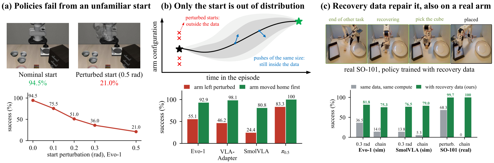
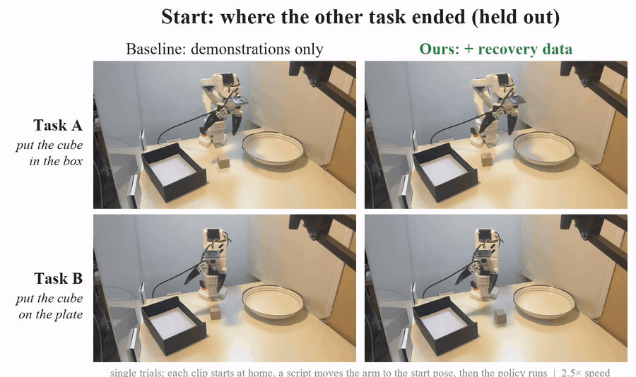
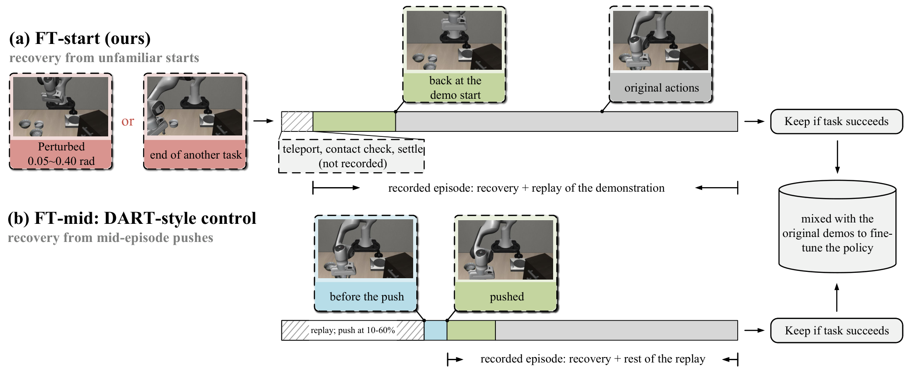

<h1 align="center">Never Seen This Start</h1>

<h3 align="center">Diagnosing and Repairing Initial-State Brittleness in Lightweight Vision-Language-Action Models</h3>

<p align="center">
  
  
  
  
</p>

Every LIBERO demonstration starts from the same arm configuration. Policies trained on these demonstrations fail when
the arm starts anywhere else, even though they recover from equally large pushes in the middle of an episode. We
diagnose this for Evo-1, VLA-Adapter, SmolVLA and π0.5 with paired, interventional experiments (49,837 simulated
episodes). We then repair it with start-diversified recovery data, which is synthesised in simulation without new
human demonstrations and transfers to a real SO-101 arm.

<p align="center"></p>

## Real robot: starting where another task ended

The two policies were fine-tuned from SmolVLA on the same 100 teleoperated demonstrations. The policy on the right
also saw automatically recorded recovery clips. The clip below plays at 2.5× speed; a one-minute summary is in
[`assets/demo_1min.mp4`](assets/demo_1min.mp4).

<p align="center"></p>

| start (3 training runs × 100 trials) | demonstrations only | + recovery data |
|---|:---:|:---:|
| home pose | 300/300 | 300/300 |
| held-out perturbed poses | 205/300 | **299/300** |
| end of the other task | 0/300 | **300/300** |

## Diagnosis

The failure is specific to the start: success falls steadily with the size of a start perturbation. Moving the arm
home before execution, which changes nothing but the arm configuration, restores the success of every model.

| success (%) | Evo-1 | VLA-Adapter | SmolVLA | π0.5 |
|---|:---:|:---:|:---:|:---:|
| clean LIBERO | 94.5 | 98.0 | 77.5 | 97.0 |
| LIBERO-plus robot init., arm left perturbed | 55.1 | 46.2 | 24.4 | 83.3 |
| LIBERO-plus robot init., arm moved home first | 92.9 | 98.1 | 80.8 | 100 |

Evo-1 on clean LIBERO, by start perturbation:

| perturbation | 0 | 0.1 rad | 0.2 rad | 0.3 rad | 0.5 rad |
|---|:---:|:---:|:---:|:---:|:---:|
| success (%) | 94.5 | 75.5 | 51.0 | 36.0 | 21.0 |

## Remedy: start-diversified recovery data

<p align="center"></p>

The pipeline works in four steps:

1. The arm is placed in an unfamiliar start: a joint perturbation, or the pose in which another task ended.
2. A controller drives the arm back to the start pose of the demonstration.
3. The original actions are replayed. Only successful episodes are kept, and recording starts with the recovery.
4. The kept episodes are mixed with the original demonstrations for fine-tuning.

The DART-style control (FT-mid) records recoveries from mid-episode pushes instead.

Evo-1, success (%):

| | released | FT-orig† | FT-mid | FT-start† | **FT-start+chain**† |
|---|:---:|:---:|:---:|:---:|:---:|
| clean LIBERO | 94.5 | 88.8 | 77.0 | 86.0 | 86.5 |
| start 0.3 rad | 36.0 | 36.5 | 32.0 | 71.5 | **81.8** |
| start 0.5 rad (outside the synthesis range) | 21.0 | 18.8 | 20.0 | 50.8 | **70.0** |
| LIBERO-plus robot init. | 55.1 | 51.3 | 46.8 | 74.1 | **82.4** |
| task chaining | 15.5 | 14.0 | 12.5 | 12.5 | **75.3** |

SmolVLA, success (%):

| | released | FT-orig† | **FT-start+chain**† |
|---|:---:|:---:|:---:|
| clean LIBERO | 77.5 | 74.8 | 81.3 |
| start 0.3 rad | 16.0 | 13.8 | **76.5** |
| LIBERO-plus robot init. | 24.4 | 19.6 | **85.3** |
| task chaining | 2.5 | 5.3 | **79.0** |

† mean of two training runs. FT-orig is equal-compute fine-tuning on the original data.

## Repository layout

| folder | contents |
|---|---|
| `probe/` | `probe_server.py` (one websocket server, three model adapters: `evo1`, `vla_adapter`, `lerobot`), `probe_client.py` (rollouts and interventions), `probe_analyze.py` (all diagnosis tables), helpers (`make_homing_ref.py`, `make_chain_starts.py`, `split_chain_pool.py`, `demo_init_stats.py`) and the experiment queues `queue_*.sh` |
| `remedy/` | `synth_libero.py` (synthesis, modes `start` / `chain` / `mid` / `replay`), `build_lerobot_v21.py`, `compare_datasets.py`, `prepare_evo1_finetune.py`, `make_variant.py`, `subset_dataset.py`, `truncate_mid.py`, `run_synth.sh`, `run_ft_chain.sh` |
| `smolvla/` | conversion of the synthetic datasets to SmolVLA's LeRobot format and equal-compute fine-tuning |
| `pilot/` | the first Evo-1-only evaluation (LIBERO-plus subset, server/client), whose clean runs `make_homing_ref.py` uses |
| `real/` | `build_real_dataset.py`, `train_real.sh`; `real/so101/`: teleoperation, data collection with automatic recovery clips, policy server, evaluation, analysis and offline tests |

Every script starts with a docstring that describes its arguments and gives an example command.

## Setup

All paths are relative to one work directory, set by the variable `W`:

```bash
export W=/path/to/work
```

The layout under `W` is:

- `$W/code/` holds this repository and the upstream code;
- `$W/ckpt/` holds the checkpoints;
- `$W/data/` holds LIBERO hdf5 and LeRobot datasets;
- `$W/outputs/` holds the results.

| environment | used for |
|---|---|
| `libero` (Python 3.8) | clean-LIBERO rollouts, synthesis |
| `libero_plus` (Python 3.10) | LIBERO-plus rollouts |
| `Evo1` | Evo-1 server and fine-tuning |
| `vla_adapter` | VLA-Adapter server |
| `lerobot` | SmolVLA and π0.5 servers, SmolVLA fine-tuning, real robot |

Checkpoints are the released LIBERO checkpoints of each model:

- Evo-1;
- VLA-Adapter (one per suite);
- `HuggingFaceVLA/smolvla_libero`;
- the LeRobot π0.5 LIBERO port;
- `lerobot/smolvla_base` for the real robot.

Rendering uses EGL. Set `MUJOCO_GL=egl` in the launching shell; the queue scripts do this themselves.

## Reproducing the paper

1. **Diagnosis.**
   - Start the probe servers for one model (ports are listed at the top of each queue).
   - Run its queue, for example `bash probe/queue_evo1.sh`.
   - Then run `python probe/probe_analyze.py`.
   - Condition tags in the result folders:
     - `C*` — clean LIBERO, with input interventions;
     - `P0*` — LIBERO-plus;
     - `H0*` / `H1*` — robot-init category without / with homing;
     - `X*` — mid-episode pushes;
     - `S*` — state bias.
     - A suffix `c` means LIBERO-plus instructions with the perturbation suffix removed.
2. **Synthesis.**
   - Run `MODES="start mid" bash remedy/run_synth.sh` for the perturbed starts and the DART-style control.
   - Run `MODES=chain SYNTH_ARGS="--recovery-steps 400" bash remedy/run_synth.sh` for the task-chaining starts. It
     needs `probe/make_chain_starts.py` and `probe/split_chain_pool.py` first.
3. **Fine-tuning.**
   - Evo-1: `remedy/prepare_evo1_finetune.py`, then `remedy/run_ft_chain.sh`.
   - SmolVLA: `smolvla/build_smolvla_dataset.py`, then `smolvla/train_smolvla.sh`.
4. **Evaluation of the fine-tuned policies.** Run `probe/queue_remedy.sh` (Evo-1) and
   `probe/queue_remedy_smol.sh` (SmolVLA).
5. **Real robot.**
   - Collect: `real/so101/collect_data.py`.
   - Build the datasets: `real/build_real_dataset.py`.
   - Train: `real/train_real.sh`.
   - Evaluate: `real/so101/policy_server.py` together with `real/so101/eval_real.py`.
   - Summarise: `real/so101/analyze_real.py`.
   - Held-out start poses are in `real/so101/setup/poses.json`; calibration files are robot-specific and not included.

## Citation

The paper is under double-anonymous review. Citation information will be added after the review.

## License

MIT (see `LICENSE`). The model adapters call, but do not include, the code of Evo-1, VLA-Adapter, LeRobot, LIBERO and
LIBERO-plus, which are distributed under their own licenses.
